<p align="center">
  <h1 align="center">🌙 MoonLake: Real-Time 3D Simulation & Rendering Engine</h1>
  <p align="center">
    <strong>A high-performance modern C++ & OpenGL 3.3 Core graphics simulation featuring analytical primitives, continuous procedural terrain, Gerstner water dynamics, multi-source Blinn-Phong illumination, directional PCF shadow mapping, and real-time analytical GPU ray tracing.</strong>
  </p>
  <p align="center">
    
    
    
    
    
  </p>
</p>

---

## 🌟 Visual Showcase

<p align="center">
  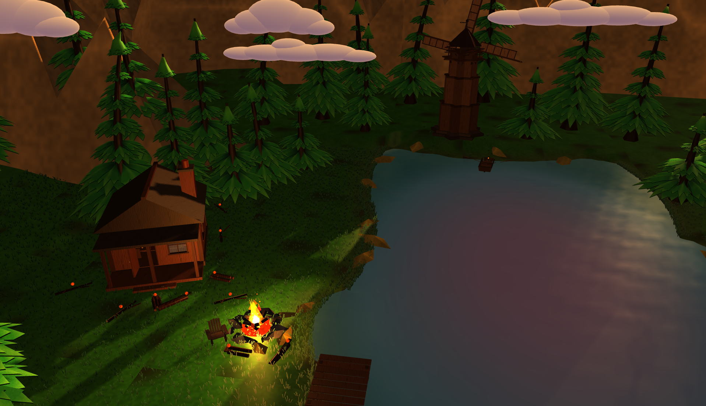
</p>

### 📸 Scenic Views Across Celestial Presets

| 🌅 Golden Hour / Sunset Vista | 🌌 Midnight Lunar Atmosphere |
| :---: | :---: |
| 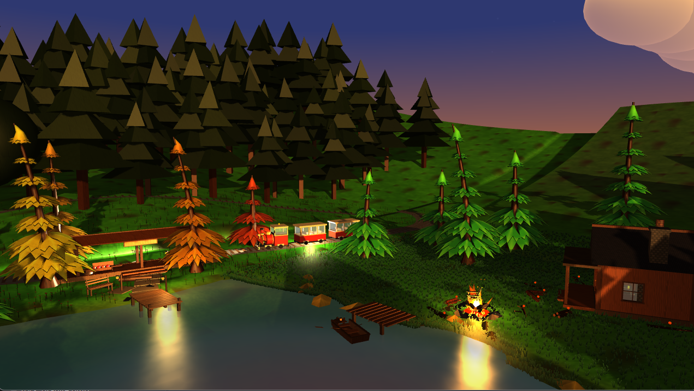 | 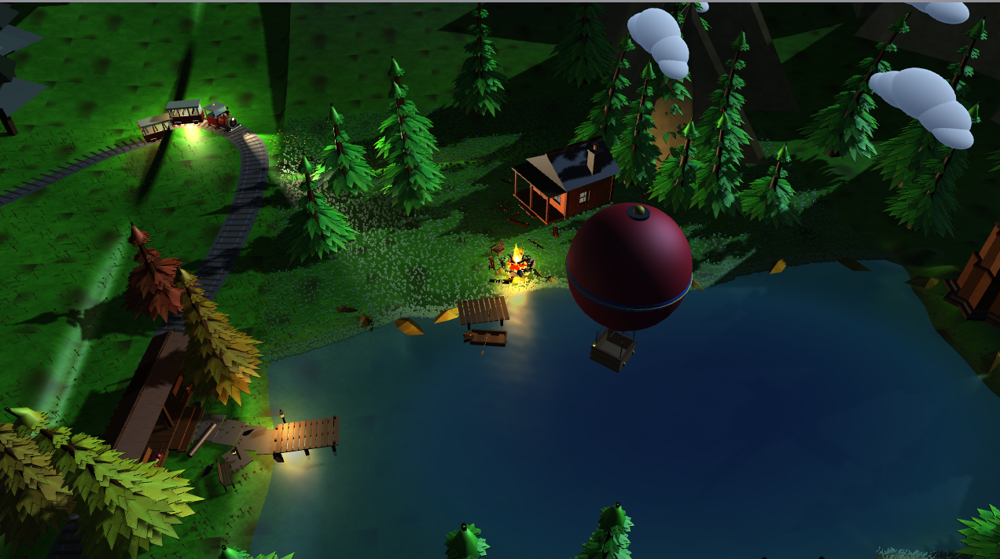 |

| 🚂 Catmull-Rom Tourist Railway | 🏛️ Cavern Treasure Sanctum |
| :---: | :---: |
| 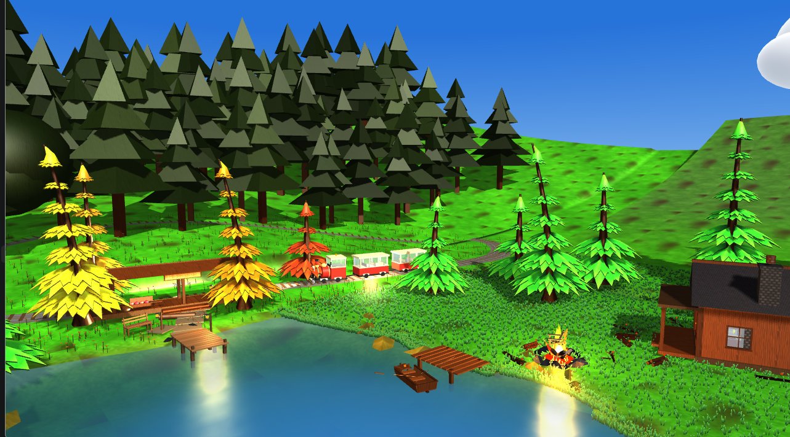 | 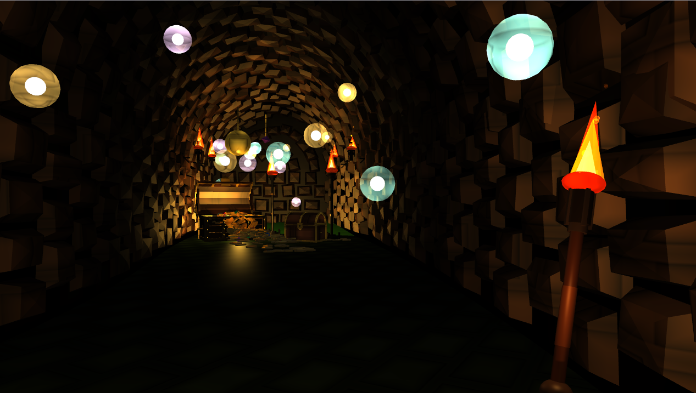 |

---

## 📋 Table of Contents

- [Visual Showcase](#-visual-showcase)
- [Key Architectural Highlights](#-key-architectural-highlights)
- [Lighting, Shading & Shadow Architecture](#-lighting-shading--shadow-architecture)
- [Analytical GPU Ray Tracing](#-analytical-gpu-ray-tracing-gold-coins)
- [Procedural Geometry & Primitives](#-procedural-geometry--primitives)
- [Curves, Splines & Physics Simulation](#-curves-splines--physics-simulation)
- [Object & Asset Showcase](#-object--asset-showcase)
- [Interactive Controls](#-interactive-controls)
- [Project Structure](#-project-structure)
- [Prerequisites & Build Instructions](#-prerequisites--build-instructions)
- [Dependencies](#-dependencies)
- [Author](#-author)

---

## 🚀 Key Architectural Highlights

* **Pure Code Geometry — Zero External 3D Models (.obj/.fbx):** Every 3D model, vehicle, structure, and landscape element is built from scratch by combining **10 unit mathematical primitives** through hierarchical transformation matrices ($\mathbf{M} = \mathbf{T} \times \mathbf{R} \times \mathbf{S}$).
* **Continuous Organic Terrain ($170\text{m} \times 190\text{m}$):** A subdivided grid ($170 \times 190$ cells, 32,661 vertices) evaluated via continuous analytical elevation functions, sinuous trigonometric shorelines, and central-difference normal calculations.
* **Dynamic 4-Component Gerstner Lake Basin:** Real-time trochoidal fluid displacement with analytical partial-derivative normals, Schlick Fresnel reflectance, and water depth absorption.
* **Directional Shadow Mapping ($2048 \times 2048$ FBO):** Two-pass off-screen shadow mapping with adaptive slope-scaled bias and **9-tap Percentage-Closer Filtering (PCF)** for soft penumbra shadows.
* **Real-Time Analytical GPU Ray Tracing:** Hybrid pipeline embedded inside the fragment shader performing ray-sphere and ray-AABB intersections, multi-bounce golden radiosity, and contact crevice ambient occlusion for gold coins.
* **175-Meter Catmull-Rom Spline Railway:** 16-point closed-loop tourist railway with arc-length parameterization for uniform train velocity and moving locomotive spotlight.
* **Multi-Source Illumination:** Global celestial directional light across 3 time-of-day presets, 5 distance-attenuated point lights, and a dual-cone spotlight.
* **Dynamic Weather & Thunder Simulation:** 1,500-particle continuous rain system with heightmap collision and procedural 3D branching lightning bolts with a 4-phase flash envelope.

---

## 💡 Lighting, Shading & Shadow Architecture

### 1. Blinn-Phong Reflection Pipeline
Surfaces are shaded per-fragment using the Blinn-Phong reflection model:
$$I_{\text{total}} = I_{\text{ambient}} + I_{\text{diffuse}} + I_{\text{specular}}$$
* **Ambient Reflection:** Models environmental background illumination.
* **Lambertian Diffuse:** Angle-dependent matte scattering based on $\max(\mathbf{n} \cdot \mathbf{l}, 0)$.
* **Blinn-Phong Specular:** Uses the halfway vector $\mathbf{h} = \frac{\mathbf{l} + \mathbf{v}}{\|\mathbf{l} + \mathbf{v}\|}$, with shininess exponents $\alpha \in [16, 96]$.

### 2. Directional Shadow Mapping (Hard vs. 9-Tap PCF)
A $2048 \times 2048$ 24-bit depth map renders occluders from the light's perspective. In the fragment pass, an adaptive slope-scaled bias prevents surface acne, while a $3 \times 3$ grid of samples softens shadow edges:

| 9-Tap PCF Soft Filtered Shadows (Active) | Unfiltered Hard Shadow Map (Reference) |
| :---: | :---: |
| 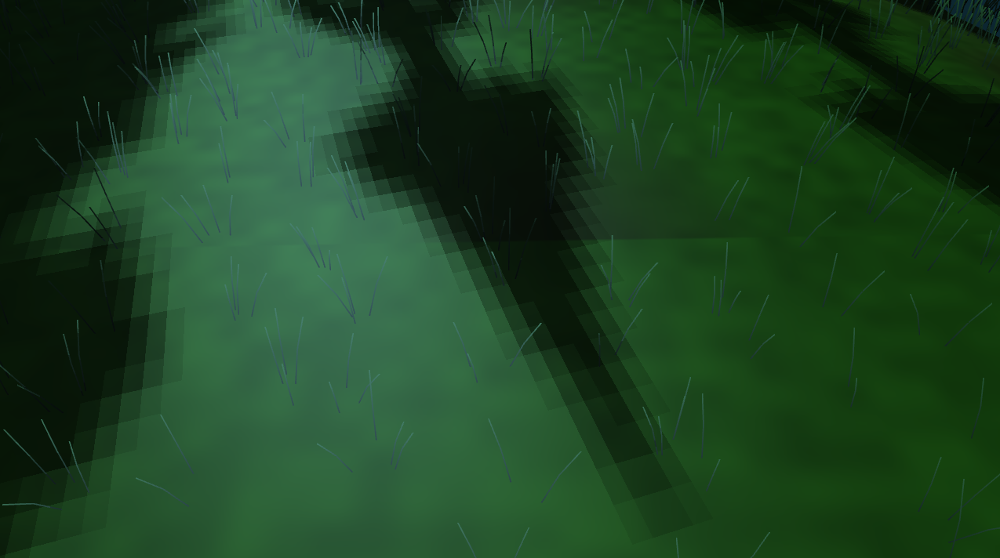 | 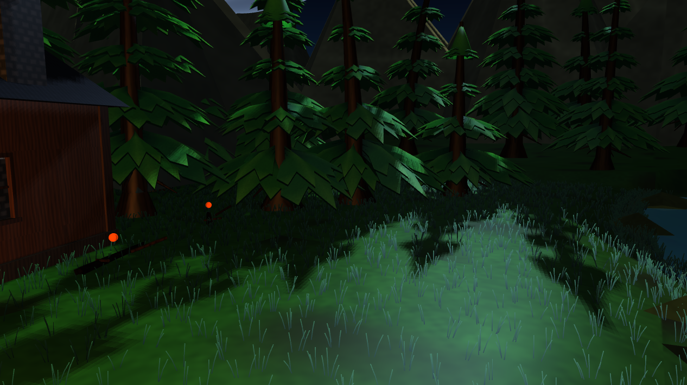 |

### 3. Light Source Breakdown

| Directional Celestial Light | Localized Point Lights | Moving Train Spotlight |
| :---: | :---: | :---: |
| 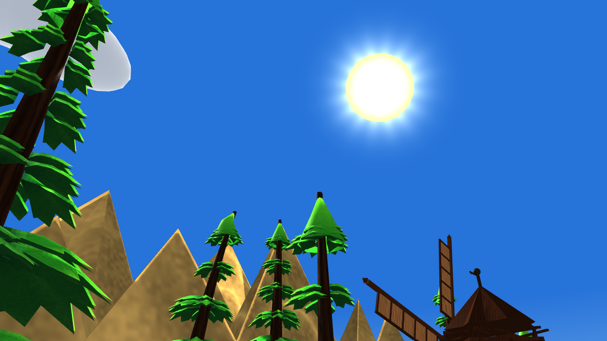 | 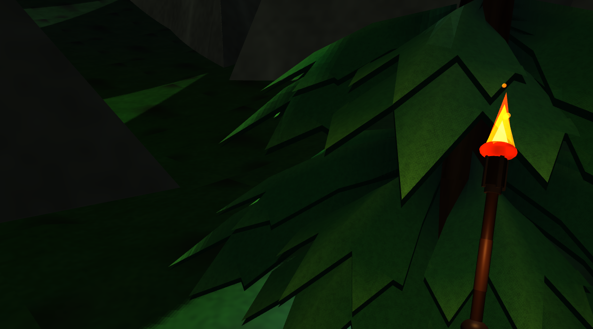 | 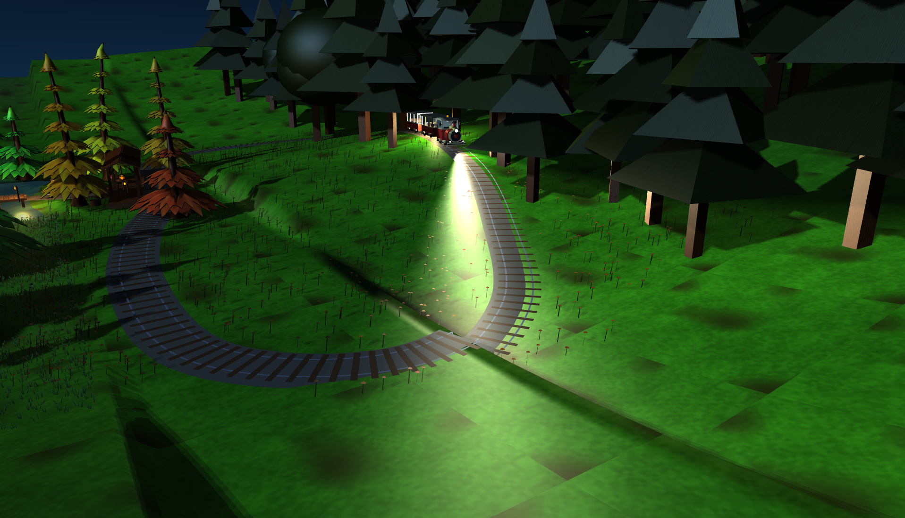 |
| Parallel rays across Day, Sunset, and Night presets with zero distance loss. | Quadratic attenuation: $A(d) = \frac{1}{k_c + k_l d + k_q d^2}$ with smooth cutoff. | Focused conical beam with inner ($\theta_{\text{in}}$) and outer ($\theta_{\text{out}}$) penumbra falloff. |

<p align="center">
  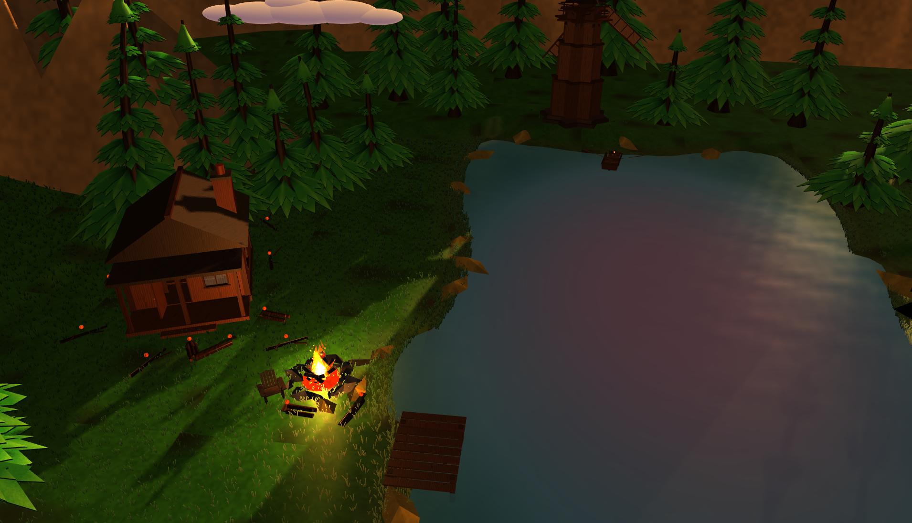
  <em>Three Dynamic Celestial Presets: Night (Cool Moon), Sunset (Warm Amber), and Day (Highland Sun).</em>
</p>

---

## 💎 Analytical GPU Ray Tracing (Gold Coins)

Inside the subterranean cavern sanctum, hundreds of metallic gold coins sit stacked in a mahogany treasure chest. While standard rasterized Blinn-Phong fails to capture inter-reflections and contact occlusion, an analytical GPU ray tracer solves this directly inside [`shaders/raytracing_coins.glsl`](shaders/raytracing_coins.glsl):

<p align="center">
  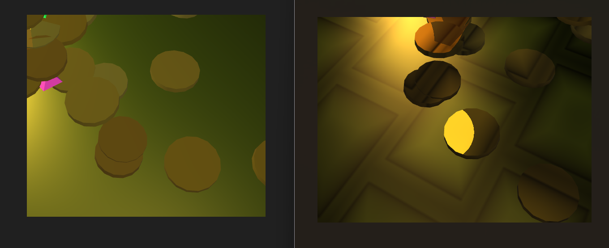
  <em>Side-by-side comparison: Active Real-Time Ray Tracing (left) vs. Rasterized Blinn-Phong Fallback (right).</em>
</p>

* **Ray-Sphere Intersection:** Solves quadratic $\|\mathbf{o} + t\mathbf{d} - \mathbf{c}\|^2 = r^2$ for the glowing crystal lantern orb and neighboring coin clusters.
* **Ray-AABB Intersection (Kay-Kajiya Slabs):** Intersects the mahogany chest boundaries.
* **Secondary Reflection Rays (Multi-Bounce Radiosity):** Bounces rays along $\mathbf{r}_{\text{refl}} = \text{reflect}(-\mathbf{v}, \mathbf{n})$. Repeated blue-wavelength absorption enriches saturated amber tones.
* **Secondary Shadow Rays (Crevice Ambient Occlusion):** Casts rays to the local light; occluded coins receive a $0.32\times$ contact shadow.
* **Cook-Torrance Conductor Fresnel:** Uses physical gold reflectance at normal incidence $F_0 = (1.00, \; 0.78, \; 0.34)$.
* **Toggle in Real Time:** Press **`[R]`** to switch between ray tracing and rasterization!

---

## 📐 Procedural Geometry & Primitives

All structures are assembled hierarchically from **10 Unit Geometric Primitives** stored in GPU VRAM (36-byte vertex stride: Position `vec3`, Normal `vec3`, Color `vec3`):

1. **Unit Cube:** 36 vertices with perpendicular outward face normals.
2. **UV Sphere:** Sliced into latitude stacks ($\phi$) and longitude sectors ($\theta$) with analytical radial normals $\mathbf{n} = \mathbf{p} / r$.
3. **Unit Cylinder:** Circular caps with axial normals and curved side wall with outward radial normals.
4. **Square Pyramid:** Base quad plus 4 triangular facets with cross-product surface normals $\mathbf{n} = \frac{\mathbf{e}_1 \times \mathbf{e}_2}{\|\mathbf{e}_1 \times \mathbf{e}_2\|}$.
5. **Triangular Prism (Gable Roof):** Sloped roof planes meeting at a central ridge.
6. **Plane:** Horizontal ground/water plane or vertical sign plane.
7. **Procedural Faceted Rock:** 6-sided asymmetric bipyramid with sine-wave radial jitter.
8. **Tapered Branch:** 5-sided cylindrical trunk with $35\%$ tip radius tapering.
9. **Grass Tuft:** Double-sided crossed blade quads angled at $45^\circ$ increments.
10. **Glow Billboard Quad:** Screen-aligned billboard with exponential radial falloff ($e^{-4d}$).

---

## 🚂 Curves, Splines & Physics Simulation

### 1. 16-Point Catmull-Rom Tourist Railway
The 175-meter railway track loops through the campsite, flower meadows, mountain passes, and ridge vistas using a closed-loop Catmull-Rom spline:
$$\mathbf{p}(u) = \frac{1}{2} \left[ 2\mathbf{p}_0 + (-\mathbf{p}_{-1} + \mathbf{p}_1)u + (2\mathbf{p}_{-1} - 5\mathbf{p}_0 + 4\mathbf{p}_1 - \mathbf{p}_2)u^2 + (-\mathbf{p}_{-1} + 3\mathbf{p}_0 - 3\mathbf{p}_1 + \mathbf{p}_2)u^3 \right]$$
* **$C^1$ Continuity:** Ensures zero sudden velocity changes or jerks.
* **Track Extrusion:** Evaluates tangent vectors $\mathbf{t}(u) = \mathbf{p}'(u)$ and perpendicular right vectors to place parallel steel rails, wooden sleepers, and gravel ballast.

### 2. Gerstner Water Dynamics
Four trochoidal wave components displace the lake mesh vertices in real time:
$$\mathbf{P}(x, z, t) = \mathbf{P}_0 + \sum_{i=1}^4 \begin{bmatrix} Q_i A_i D_{i,x} \cos(\omega_i t + \phi_i) \\ A_i \sin(\omega_i t + \phi_i) \\ Q_i A_i D_{i,z} \cos(\omega_i t + \phi_i) \end{bmatrix}$$

### 3. Atmospheric Thunder & Branching 3D Lightning
* **Jagged Trunk:** 16 segments displaced perpendicular to the path using a sine envelope $\sin(t\pi)$ to keep ends grounded in clouds and mountain ridges.
* **Branching Forks:** Diverges sideways at intervals, rendered with additive alpha blending (`GL_SRC_ALPHA, GL_ONE`).
* **Multi-Stroke Envelope:** A 4-phase flash curve (Rapid Stroke $\to$ Dip $\to$ Surge $\to$ Quadratic Decay) that illuminates the sky dome, cloud undersides, terrain, water, and rain.

---

## 🎨 Object & Asset Showcase

<p align="center">
  <table>
    <tr>
      <td align="center" width="33%">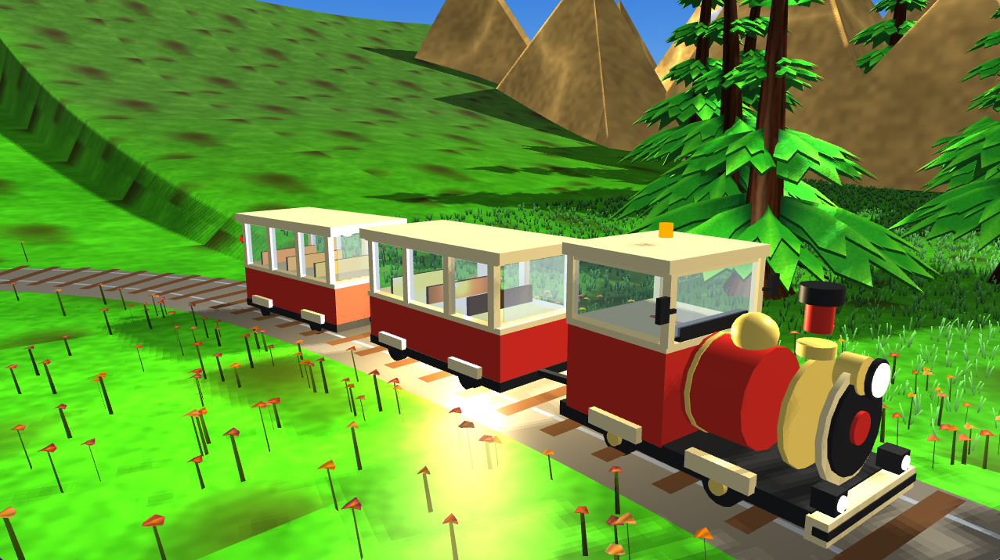<br /><b>Tourist Locomotive & Coach</b></td>
      <td align="center" width="33%">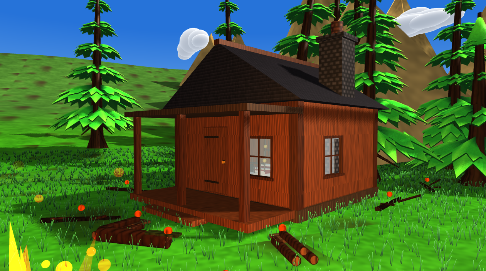<br /><b>Rustic Wooden Cabin</b></td>
      <td align="center" width="33%">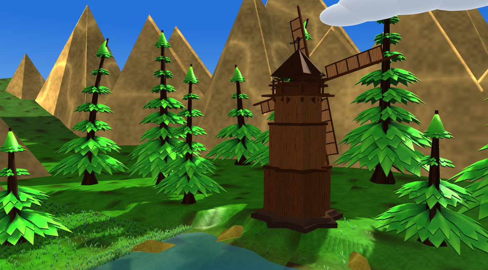<br /><b>Lakeside Windmill</b></td>
    </tr>
    <tr>
      <td align="center" width="33%">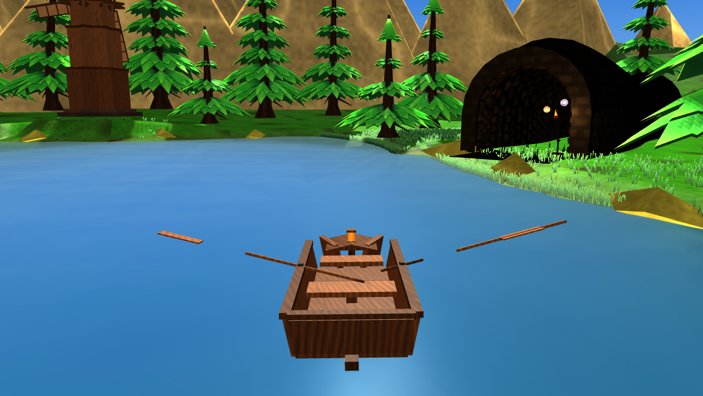<br /><b>Rowboat & Oars</b></td>
      <td align="center" width="33%">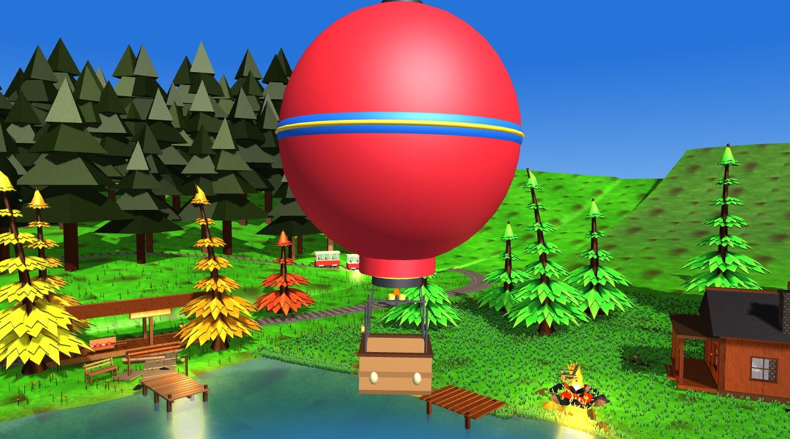<br /><b>Hot Air Balloon</b></td>
      <td align="center" width="33%">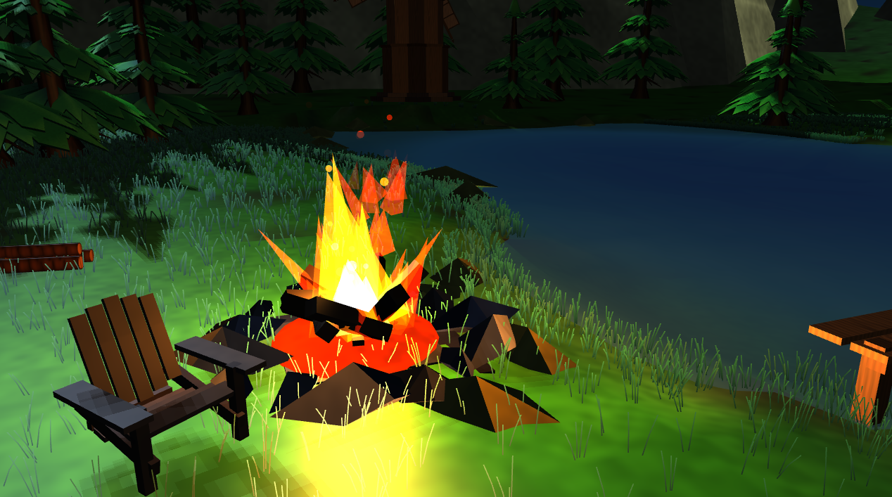<br /><b>Campfire & Stone Ring</b></td>
    </tr>
    <tr>
      <td align="center" width="33%">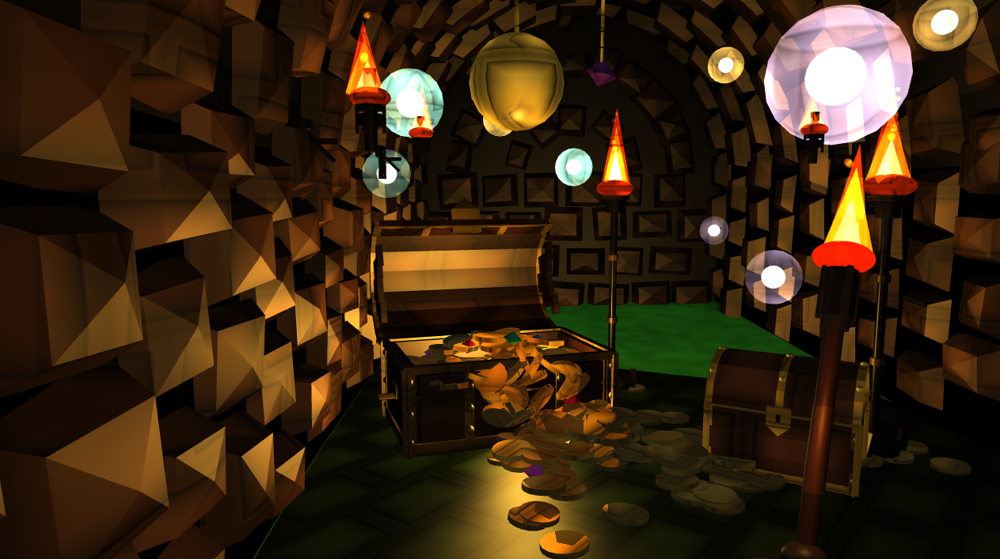<br /><b>Cavern Entrance Portal</b></td>
      <td align="center" width="33%">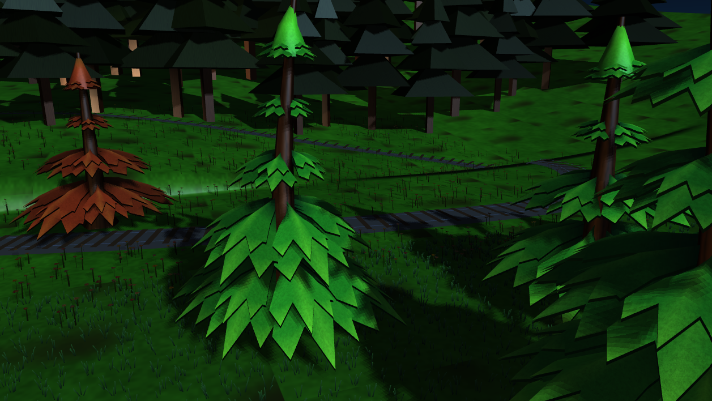<br /><b>Stylized Conifer Pines</b></td>
      <td align="center" width="33%">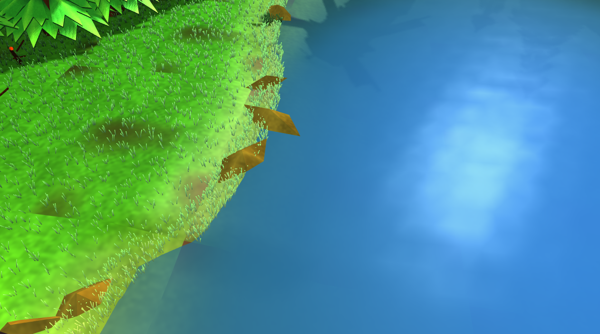<br /><b>Reflective Gerstner Lake</b></td>
    </tr>
  </table>
</p>

---

## 🎮 Interactive Controls

| Category | Key / Input | Action |
| :--- | :--- | :--- |
| **Movement** | `W` / `A` / `S` / `D` | Move forward / left / backward / right |
| | `Space` / `Left Shift` | Fly up / down |
| | `Mouse` | Look around (yaw & pitch) |
| | `Scroll Wheel` | Zoom / change Field of View |
| **Camera Modes** | `V` | Cycle camera modes (Free Flight $\to$ Boat $\to$ Balloon $\to$ Train $\to$ Guided Tour) |
| | `C` | Toggle automated **Guided Cave Tour** camera sequence |
| **Environment** | `1` / `2` / `3` | Instant jump to **Night** (`1`), **Sunset** (`2`), or **Day** (`3`) |
| | `4` | Toggle Continuous Rainstorm Simulation ON / OFF |
| | `5` | Trigger manual **Atmospheric Thunder Strike & 3D Lightning** |
| **Lighting & Ray Tracing** | `R` | Toggle **Analytical GPU Ray Tracing** of gold coins ON / OFF |
| | `L` | Toggle Lighting & Shading ON / OFF (Diagnostic unlit base color mode) |
| **Interactive Props** | `O` | Open / close rustic cabin swinging wooden door |
| | `F` | Add firewood to cabin hearth / ignite fireplace fire |
| | `T` | Pick up / place player handheld flaming torch |
| | `G` | Cycle torch flame brightness (Dim $\to$ Normal $\to$ Bright $\to$ Blazing) |
| **Vehicle Controls** | `Up` / `Down` Arrow | Rowboat throttle (Forward / Reverse) |
| | `Left` / `Right` Arrow | Steer rowboat rudder (Turn Left / Right) |
| | `ESC` | Exit application |

---

## 📁 Project Structure

```
MoonLake/
├── CMakeLists.txt              # Top-level modern CMake build configuration
├── README.md                   # Project documentation & visual gallery
├── run.bat                     # 1-click build & launch script for Windows
├── external/                   # Third-party vendor dependencies
│   ├── glad/                   # OpenGL 3.3 Core Profile loader
│   └── stb/                    # Single-header image loader (stb_image.h)
├── include/                    # Header files
│   ├── Camera.h                # First-person / orbital camera controller
│   ├── DemoTourSystem.h        # Autonomous cinematic showcase tour
│   ├── Mesh.h                  # Base Mesh class (VAO, VBO, EBO, transforms)
│   ├── MotionSystem.h          # Kinematics & harmonic motion solver
│   ├── Shader.h                # GLSL shader program loader & uniform utility
│   ├── objects/                # High-level compound scene objects
│   │   ├── AutumnArea.h        ├── Boat.h           ├── Cabin.h
│   │   ├── Campfire.h          ├── Cave.h           ├── GrassLines.h
│   │   ├── HotAirBalloon.h     ├── Mountain.h       ├── PineTree.h
│   │   ├── Rain.h              ├── TerrainMesh.h    ├── Thunder.h
│   │   ├── TouristTrain.h      ├── Water.h          └── Windmill.h
│   ├── primitives/             # 10 unit geometric primitives
│   │   ├── Branch.h            ├── Cube.h           ├── Cylinder.h
│   │   ├── GlowQuad.h          ├── GrassTuft.h      ├── Plane.h
│   │   ├── Pyramid.h           ├── Rock.h           ├── Sphere.h
│   │   └── TriangularPrism.h
│   └── texture/                # Texture management & triplanar binding
│       └── TextureManager.h
├── screenshots/                # High-resolution visual proof & comparisons (27 images)
├── shaders/                    # Core GLSL shaders (auto-copied to build dir)
│   ├── vertex.glsl             # Main forward vertex shader (MVP, normals, shadows)
│   ├── fragment.glsl           # Main forward fragment shader (Blinn-Phong, PCF)
│   ├── raytracing_coins.glsl   # Analytical GPU ray tracer for gold coins
│   ├── shadow_vertex.glsl      # Directional shadow map vertex shader
│   ├── shadow_fragment.glsl    # Directional shadow map fragment shader
│   ├── water_vertex.glsl       # Gerstner wave displacement vertex shader
│   ├── water_fragment.glsl     # Water Fresnel reflection fragment shader
│   ├── rain_vertex.glsl        # Particle streak vertex shader
│   ├── rain_fragment.glsl      # Particle streak fragment shader
│   ├── sky_vertex.glsl         # Atmospheric sky dome vertex shader
│   └── sky_fragment.glsl       # Sky dome zenith/horizon gradient fragment shader
├── src/                        # C++ Implementation source code
│   ├── main.cpp                # Main entry point & rendering loop
│   ├── Camera.cpp              ├── DemoTourSystem.cpp ├── Mesh.cpp
│   ├── MotionSystem.cpp        ├── Shader.cpp
│   ├── objects/                # Object implementations
│   ├── primitives/             # Primitive implementations
│   └── texture/                # TextureManager implementation
└── textures/                   # Seamless 2D procedural & realistic material maps
```

---

## 🛠️ Prerequisites & Build Instructions

### Prerequisites
* **Windows 10 / 11**
* **CMake 3.15 or newer**
* **C++17 Compiler:** Visual Studio 2019 / 2022 (MSVC) or MinGW-w64
* **OpenGL 3.3 capable graphics hardware**

### 1. Build and Run (Command Line)
```powershell
# Clone the repository
git clone git@github.com:Mehereen-1/MoonLake.git
cd MoonLake

# Generate build files
cmake -B build

# Compile (Debug or Release)
cmake --build build --config Release

# Run the executable
.\build\Release\MoonLake.exe
```

### 2. One-Click Script
Alternatively, double-click or run:
```powershell
.\run.bat
```

### 3. Open in Visual Studio Code
1. Open the repository root in VS Code (`code .`).
2. Make sure the **CMake Tools** and **C/C++** extensions are installed.
3. Select your compiler kit (e.g., `Visual Studio Community 2022 Release - amd64`).
4. Press **`Ctrl+Shift+B`** to build, or **`F5`** to launch with debugging.

---

## 📦 Dependencies

All third-party libraries are either vendored or fetched automatically via CMake `FetchContent`:
* [**GLFW 3.4**](https://www.glfw.org/) — Multi-platform window creation, OpenGL context management, and input handling.
* [**GLAD**](https://glad.dav1d.de/) — OpenGL 3.3 Core Profile function loader.
* [**GLM 1.0.1**](https://github.com/g-truc/glm) — Header-only mathematics library (vectors, matrices, transforms).
* [**stb_image 2.30**](https://github.com/nothings/stb) — Lightweight single-header image loader for texture assets.

---

## 👤 Author

* **Ayesha Mehereen** — [GitHub: @Mehereen-1](https://github.com/Mehereen-1)
* Email: [ayesha.mehereen01@gmail.com](mailto:ayesha.mehereen01@gmail.com)
